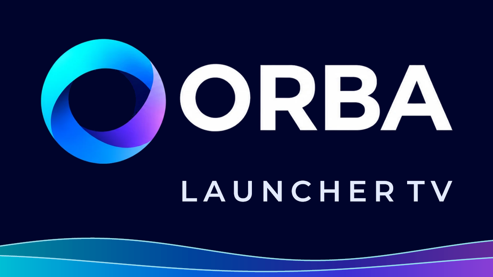
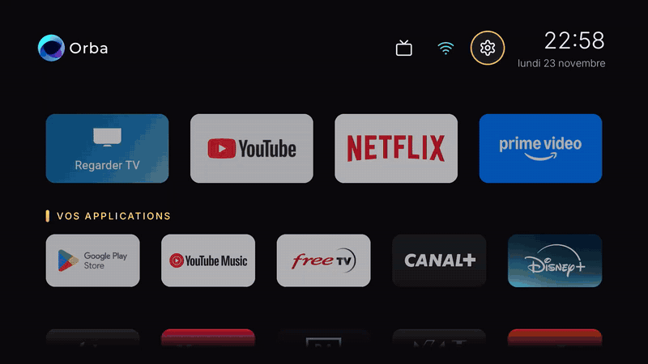
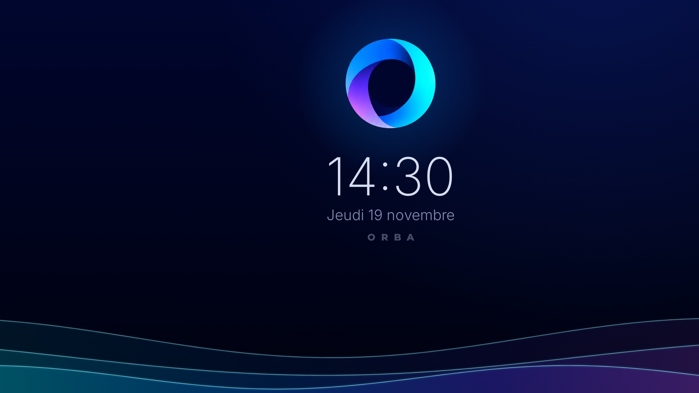
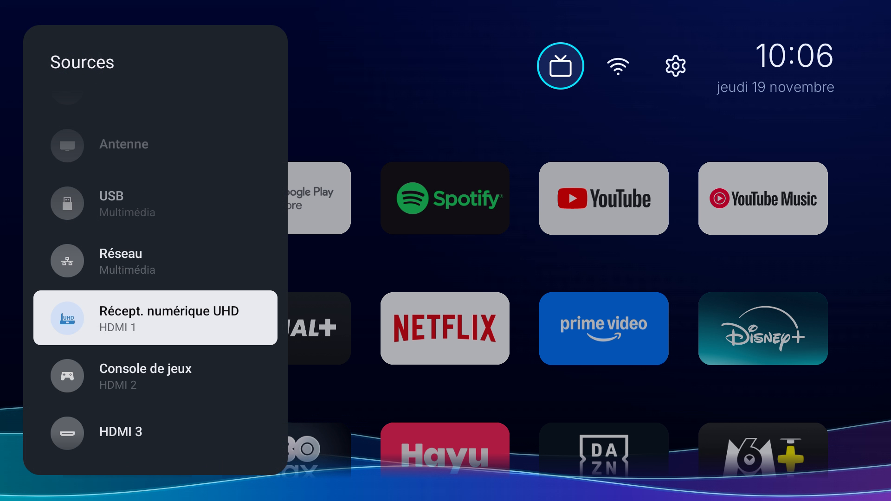

<p align="center">
  
</p>

<h1 align="center">Orba</h1>
<p align="center"><b>Le launcher TV simple et épuré pour Google TV et Android TV</b></p>

<p align="center">
  <a href="README.md">English</a> · <b>Français</b>
</p>

<p align="center">
  <a href="https://github.com/btalal/orba/releases/latest"></a>
  <a href="https://github.com/btalal/orba/releases"></a>
  <a href="LICENSE"></a>
  
  <a href="https://www.youtube.com/@OrbaTechFR"></a>
</p>

---

Orba remplace l'écran d'accueil chargé de Google TV et Android TV par un écran calme et lisible :
l'heure, la date et **vos applications**, rien d'autre. Pas de publicités, pas de
recommandations, pas de bandeaux « À regarder ensuite ».

<p align="center">
  
</p>

## Nouveau dans la version 3.8 : le dock de favoris

Vos **4 applis préférées** s'affichent en grandes tuiles en haut d'Orba, et le nom de celle qui est
sélectionnée apparaît en grand au-dessus. Appui long sur OK sur une tuile → **Ajouter aux favoris** (ou *Retirer
des favoris*) ; *Déplacer* change leur ordre. Au premier démarrage, le dock reprend les grandes applis de
streaming déjà installées.

## Version 3.7

- 🌐 **Bilingue (Français & Anglais)** : Orba suit automatiquement la langue de la télé (français ou anglais) pour tous les menus, les réglages, la date et l'écran de veille.
- 📺 **Compatible Google TV, Android TV & Xiaomi TV** :
  - Le service de raccourci Accueil détecte désormais tous les grands launchers d'origine (`launcherx` sur Google TV, `tvlauncher` / `leanbacklauncher` sur Android TV, `com.mitv.tvhome` sur Xiaomi PatchWall).
  - Orba déclare aussi la catégorie `CATEGORY_HOME` : si vous avez désactivé le launcher d'origine via ADB (par exemple avec [CleanYourTV](https://github.com/Gathin23/cleanyourtv)), Orba fonctionne comme **écran d'accueil natif** sans même avoir besoin du service d'accessibilité.
  - Compatible dès **Android 8.0 (API 26)**.
- 📦 **Applis sideloadées & Infos sur l'appli** :
  - Affiche aussi bien les applis Android TV (`LEANBACK_LAUNCHER`) que les applis Android classiques installées manuellement (`LAUNCHER`).
  - Appui long sur OK sur une tuile → **Infos sur l'appli…** ouvre directement la fiche système de l'application (pour Forcer l'arrêt, Vider le cache ou Désinstaller en deux clics).
- 🔌 **Indicateur HDMI actif & touche Sources de la télécommande** :
  - Les entrées HDMI actives affichent un point `●` dans la liste des Sources, et la touche physique **Source / Input** de la télécommande ouvre directement le panneau Sources.

## Écran de veille animé et réglages (version 3.6)

### Écran de veille animé
Après quelques minutes sans toucher la télécommande, Orba affiche son écran de veille : **l'anneau du logo
tourne lentement en pulsant**, avec l'heure et la date en dessous, et l'ensemble **dérive doucement sur tout
l'écran** au-dessus des vagues atténuées. Rien ne reste au même endroit : idéal pour les écrans **OLED**.
N'importe quelle touche revient à l'accueil (le volume reste utilisable pendant la veille).

<p align="center">
  
</p>

L'écran de veille est aussi déclaré comme **économiseur d'écran Android** (nom : *Orba*), que la télé
peut utiliser partout si sa marque propose le choix.

### Réglages directement sur la télé
Sélectionnez la **roue dentée affichée en haut d'Orba** et **maintenez la touche OK** (le bouton central de la
télécommande) pour ouvrir les *Réglages Orba* — pas le bouton Paramètres de la télécommande, qui ouvre toujours
ceux de la télé. Autre accès : appui long sur OK sur n'importe quelle tuile → *Réglages Orba…*.
Chaque choix s'applique tout de suite :

| Réglage | Choix |
|---|---|
| Tuiles par ligne | 4, 5, 6 ou 7 |
| Fond | Vagues animées · Vagues fixes · Noir pur (OLED) |
| Halo de sélection | Couleur de l'appli · Cyan Orba |
| Écran de veille | Désactivé · après 5, 10, 20 ou 30 min |
| Voir l'écran de veille | Aperçu immédiat |

Un appui court sur la roue ouvre toujours les paramètres de la télé.

## Le bouton Sources (version 3.5)

Un bouton **Sources** (icône téléviseur) dans l'en-tête, à côté du Wi-Fi : flèche haut depuis la grille,
puis OK (ou touche **Source / Input** de la télécommande), et la liste des entrées de la télé s'ouvre (HDMI avec `●` sur les ports actifs, antenne, USB…).

<p align="center">
  
</p>

- **Télés Philips** : le panneau Sources d'origine s'ouvre.
- **Autres télés Android** : la liste des entrées HDMI s'affiche dans une fenêtre aux couleurs d'Orba.

▶️ Démonstration en vidéo : [Orba 3.5 : le nouveau bouton Sources](https://www.youtube.com/watch?v=y7Pzcqimt1k)

## Fonctionnalités

- **Accueil épuré** : logo, heure, date et une grille d'applications (4 à 7 par ligne, y compris les applis sideloadées) avec les logos d'origine.
- **Halo lumineux** à la couleur de chaque appli quand on la sélectionne, et son nom affiché dessous.
- **Fond animé** bleu nuit avec des vagues lumineuses cyan → violet (et un léger décalage périodique de l'en-tête) qui protègent les écrans **OLED** du marquage.
- **Écran de veille animé** (logo, heure, date en dérive lente) et **réglages sur la télé**.
- **En-tête** avec le bouton **Sources**, l'icône **Wi-Fi** (force du signal ; un clic ouvre les réglages réseau) et la roue **Paramètres**.
- **Organisation libre** : appui long sur OK sur une tuile → *Déplacer*, *Infos sur l'appli…*, *Masquer de l'accueil* ou *Applis masquées…*. La tuile **+** réaffiche une appli masquée.
- **Démarre en premier** : à l'allumage de la télé et sur la touche **Accueil**, c'est Orba qui s'affiche.
  **Appui long** sur Accueil : l'accueil Google TV / Android TV d'origine reste accessible.
- **Bilingue** : français et anglais (suit automatiquement la langue de la télé).
- **Ultra-léger et respectueux de la vie privée** : environ 315 Ko, aucune permission Internet, aucune pub, aucun pistage.

## Installer Orba sur une télé Android / Google TV

Prérequis : une télé ou un boîtier **Google TV / Android TV** sous **Android 8.0 ou plus récent**.

### Méthode A — Sans ordinateur (en conservant le launcher d'origine)

1. **Télécharger l'APK** depuis la page [Releases](../../releases) du projet (`orba.apk`).
2. **L'installer sur la télé**, au choix :
   - avec l'appli **Downloader** (Play Store) : saisir l'adresse de l'APK, puis *Installer* ;
   - avec une **clé USB** et un gestionnaire de fichiers ;
   - depuis un ordinateur avec **ADB** (débogage réseau activé sur la télé) :
     ```bash
     adb connect <adresse-ip-de-la-tele>:5555
     adb install -r orba.apk
     ```
   Android demandera d'autoriser l'installation d'applis de cette source : accepter pour l'appli utilisée.
3. **Activer le raccourci Accueil** (indispensable pour qu'Orba s'ouvre au démarrage et sur la touche Accueil quand le launcher d'origine est toujours actif) :
   *Paramètres → Système → Accessibilité → Services → Touche Accueil → Orba → Activer*
4. Appuyer sur la touche **Accueil** : Orba s'affiche. C'est prêt.

> **Pourquoi un service d'accessibilité ?** Google TV ne permet pas de choisir un autre écran d'accueil sans ADB.
> Le service « Touche Accueil → Orba » voit **uniquement** la touche Accueil et le nom de l'appli affichée
> (pour remplacer l'accueil d'origine quand il apparaît). Il ne lit pas le contenu de l'écran (`canRetrieveWindowContent="false"`) et n'enregistre rien.

### Méthode B — Accueil natif (après nettoyage via ADB / CleanYourTV)

Si vous avez désactivé le launcher d'origine via ADB (par exemple avec [CleanYourTV](https://github.com/Gathin23/cleanyourtv)),
Orba déclare `android.intent.category.HOME` et répond **nativement** à la touche Accueil sans avoir besoin du service d'accessibilité :

```bash
adb connect <adresse-ip-de-la-tele>:5555
adb install -r orba.apk
adb shell cmd package set-home-activity fr.maison.accueil/.MainActivity
```

> **Télés Philips :** ne désactivez pas l'appli *Aide* (`org.droidtv.eum`) : le panneau Sources en a besoin
> pour s'ouvrir. Orba la masque simplement de l'accueil par défaut.

### Revenir en arrière

Désactiver le service dans *Paramètres → Système → Accessibilité*, ou désinstaller Orba
(*Paramètres → Applications → Orba → Désinstaller*). L'accueil d'origine revient tel quel.

## Téléviseurs et boîtiers testés

| Télé / boîtier | Système | Statut |
|---|---|---|
| **Philips 65OLED908/12** | Google TV 14 | ✅ Testé au quotidien : touche Accueil, panneau Sources d'origine, écran de veille, réglages, français et anglais |
| Autres télés et boîtiers Google TV / Android TV (Sony, TCL, Hisense, Xiaomi, NVIDIA Shield, Chromecast avec Google TV…) | Android 8.0 ou plus récent | ❔ Pas encore testé. Orba est prévu pour eux (il reconnaît les accueils d'origine `launcherx`, `tvlauncher`, `leanbacklauncher` et `com.mitv.tvhome` de Xiaomi), mais personne ne nous a encore fait de retour |

*Vous utilisez Orba sur un autre modèle ? Racontez-nous dans les [Discussions](../../discussions) ou avec un
[signalement de bug](../../issues/new/choose), et votre télé rejoindra ce tableau.*

## Nettoyer sa télé (facultatif)

[`tools/`](tools/README.md#outils-de-nettoyage-de-la-télé) contient deux scripts PowerShell qui **désactivent**
(sans jamais désinstaller) les applis inutiles d'une télé Android via ADB, avec sauvegarde et journal, et la liste
testée sur la **Philips 65OLED908** : Samba TV et statistiques Philips, rapports Google, mode démo, Control4,
Alexa, Play-Fi… Tout revient avec `tools\restore.ps1`.

## Construire l'APK soi-même (Windows)

Aucun Gradle : l'APK est construit directement avec les outils du SDK Android en deux secondes.

- Android SDK (build-tools et une plateforme récente) dans `%LOCALAPPDATA%\Android\Sdk`
- Le JDK fourni avec Android Studio (`C:\Program Files\Android\Android Studio\jbr`)

```powershell
.\build.ps1        # compile, assemble, aligne et signe -> accueil-simple.apk
.\icone.ps1        # (re)génère l'icône, la bannière et le logo depuis source-logo\
```

`build.ps1` crée une clé de signature locale `cle-accueil.jks` si elle n'existe pas.
**Elle n'est pas dans le dépôt** : la conserver précieusement, car une mise à jour ne peut
s'installer par-dessus que si elle est signée avec la même clé.

GitHub construit aussi l'APK à chaque envoi et à chaque pull request (onglet *Actions*), et joint un `orba.apk`
signé à la version publiée quand une étiquette `v*` est envoyée (voir [CONTRIBUTING.md](CONTRIBUTING.md#releases-maintainer)).

## Contribuer

Idées, bugs et traductions sont les bienvenus : voir [CONTRIBUTING.md](CONTRIBUTING.md#contribuer-à-orba), les
[formulaires de ticket](../../issues/new/choose) et les [Discussions](../../discussions). Les changements de chaque
version sont dans [CHANGELOG.md](CHANGELOG.md).

## Organisation du code

| Chemin | Rôle |
|---|---|
| `src/fr/maison/accueil/MainActivity.java` | Écran d'accueil : en-tête, grille, halo, menus, infos appli, réglages, fond animé |
| `src/fr/maison/accueil/Veille.java`, `VeilleActivity.java`, `OrbaDream.java` | Écran de veille animé (et économiseur d'écran Android) |
| `src/fr/maison/accueil/ToucheAccueilService.java` | Service d'accessibilité : touche Accueil et remplacement de l'accueil d'origine |
| `res/` | Icône, bannière, logo, icône Paramètres, textes EN/FR |
| `assets/` | Polices Inter et Montserrat (licence OFL) |
| `source-logo/` | Logo Orba d'origine (image et SVG) |
| `build.ps1`, `icone.ps1`, `Logo.cs` | Construction de l'APK et génération des visuels |
| `tools/` | Scripts de nettoyage de la télé et liste testée sur la Philips 65OLED908 |
| `.github/` | Construction automatique de l'APK, formulaires de ticket et liste de vérification des pull requests |

## Licence et crédits

- Code sous **licence MIT** (voir [LICENSE](LICENSE)). Le nom et le logo « Orba » ne sont pas couverts par cette licence (voir [NOTICE](NOTICE)).
- Polices **[Inter](https://rsms.me/inter/)** et **[Montserrat](https://github.com/JulietaUla/Montserrat)** — SIL Open Font License 1.1 (licences dans `assets/`).
- Icônes Paramètres, Sources et Wi-Fi d'après **[Lucide](https://lucide.dev)** — licence ISC.
- Logos des applications : ceux fournis par chaque application installée (marques de leurs propriétaires respectifs).
