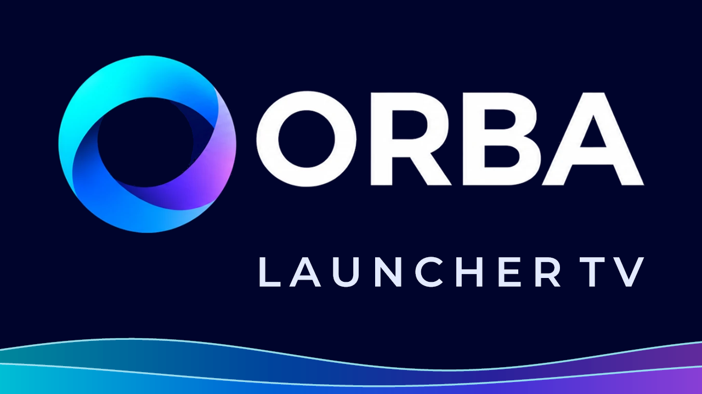

<p align="center">
  
</p>

<h1 align="center">Orba</h1>
<p align="center"><b>Le launcher TV simple et épuré pour Google TV et Android TV</b></p>

---

Orba remplace l'écran d'accueil chargé de Google TV par un écran calme et lisible :
l'heure, la date et **vos applications**, rien d'autre. Pas de publicités, pas de
recommandations, pas de bandeaux « À regarder ensuite ».

<p align="center">
  
</p>

## Fonctionnalités

- **Accueil épuré** : logo, heure, date et une grille de 5 applications par ligne avec les logos d'origine.
- **Halo lumineux** à la couleur de chaque appli quand on la sélectionne, et son nom affiché dessous.
- **Fond animé** bleu nuit avec des vagues lumineuses cyan → violet ; elles bougent lentement, ce qui protège les écrans **OLED** du marquage.
- **En-tête** avec l'icône **Wi-Fi** (force du signal ; un clic ouvre les réglages réseau) et la roue **Paramètres**.
- **Organisation libre** : appui long sur OK sur une tuile → *Déplacer*, *Masquer de l'accueil* ou *Applis masquées…*. La tuile **+** permet de réafficher une appli masquée. L'ordre est mémorisé.
- **Démarre en premier** : à l'allumage de la télé et sur la touche **Accueil** de la télécommande, c'est Orba qui s'affiche.
  **Appui long** sur Accueil : l'accueil Google TV d'origine reste accessible.
- Très léger : environ 300 Ko, aucune autorisation sensible, aucune connexion à Internet.

## Installer Orba sur une télé Android

Prérequis : une télé ou un boîtier **Google TV / Android TV** sous **Android 9 ou plus récent**.

1. **Télécharger l'APK** depuis la page [Releases](../../releases) du projet (`orba.apk`).
2. **L'installer sur la télé**, au choix :
   - avec l'appli **Downloader** (Play Store) : saisir l'adresse de l'APK, puis *Installer* ;
   - avec une **clé USB** et un gestionnaire de fichiers ;
   - depuis un ordinateur avec **ADB** (débogage réseau activé sur la télé) :
     ```bash
     adb connect <adresse-ip-de-la-tele>:5555
     adb install -r orba.apk
     ```
   Android demandera d'autoriser l'installation d'applis de cette source : accepter pour l'appli utilisée.
3. **Activer le raccourci Accueil** (indispensable pour qu'Orba s'ouvre au démarrage et sur la touche Accueil) :
   *Paramètres → Système → Accessibilité → Services → Touche Accueil → Orba → Activer*
   (l'intitulé exact peut varier légèrement selon la marque de la télé).
4. Appuyer sur la touche **Accueil** : Orba s'affiche. C'est prêt.

> **Pourquoi un service d'accessibilité ?** Google TV ne permet pas de choisir un autre écran d'accueil.
> Le service « Touche Accueil → Orba » voit **uniquement** la touche Accueil et le nom de l'appli affichée
> (pour remplacer l'accueil Google quand il apparaît). Il ne lit pas le contenu de l'écran et n'enregistre rien.

### Revenir en arrière

Désactiver le service dans *Paramètres → Système → Accessibilité*, ou désinstaller Orba
(*Paramètres → Applications → Orba → Désinstaller*). L'accueil Google TV revient tel quel.

## Construire l'APK soi-même (Windows)

Aucun Gradle : l'APK est construit directement avec les outils du SDK Android.

- Android SDK (build-tools et une plateforme récente) dans `%LOCALAPPDATA%\Android\Sdk`
- Le JDK fourni avec Android Studio (`C:\Program Files\Android\Android Studio\jbr`)

```powershell
.\build.ps1        # compile, assemble, aligne et signe -> accueil-simple.apk
.\icone.ps1        # (re)génère l'icône, la bannière et le logo depuis source-logo\
```

`build.ps1` crée une clé de signature locale `cle-accueil.jks` si elle n'existe pas.
**Elle n'est pas dans le dépôt** : la conserver précieusement, car une mise à jour ne peut
s'installer par-dessus que si elle est signée avec la même clé.

## Organisation du code

| Chemin | Rôle |
|---|---|
| `src/fr/maison/accueil/MainActivity.java` | Écran d'accueil : en-tête, grille, halo, menus, fond animé |
| `src/fr/maison/accueil/ToucheAccueilService.java` | Service d'accessibilité : touche Accueil et remplacement de l'accueil Google |
| `res/` | Icône, bannière, logo, icône Paramètres, textes |
| `assets/` | Polices Inter et Montserrat (licence OFL) |
| `source-logo/` | Logo Orba d'origine (image et SVG) |
| `build.ps1`, `icone.ps1`, `Logo.cs` | Construction de l'APK et génération des visuels |

## Crédits

- Polices **[Inter](https://rsms.me/inter/)** et **[Montserrat](https://github.com/JulietaUla/Montserrat)** — SIL Open Font License 1.1 (licences dans `assets/`).
- Icônes Paramètres et Wi-Fi d'après **[Lucide](https://lucide.dev)** — licence ISC.
- Logos des applications : ceux fournis par chaque application installée (marques de leurs propriétaires respectifs).
