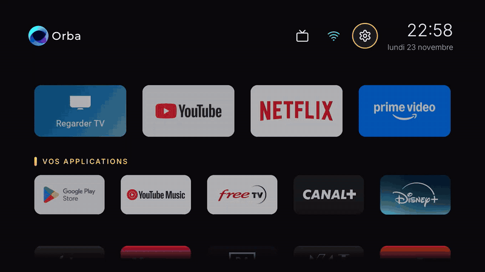
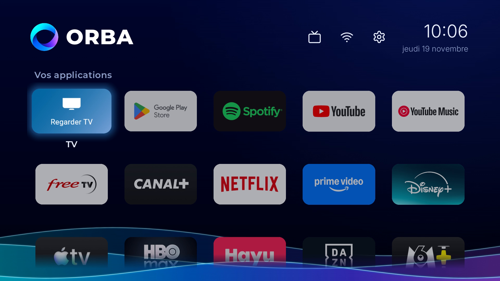

<p align="center">
  
</p>

<h1 align="center">Orba</h1>
<p align="center"><b>A simple, clutter-free launcher for Google TV and Android TV</b></p>

<p align="center">
  <b>English</b> · <a href="README.fr.md">Français</a>
</p>

<p align="center">
  <a href="https://github.com/btalal/orba/releases/latest"></a>
  <a href="https://github.com/btalal/orba/releases"></a>
  <a href="LICENSE"></a>
  
  <a href="https://www.youtube.com/@OrbaTechFR"></a>
</p>

---

Orba replaces the busy Google TV home screen with a calm, readable one: the time, the date and
**your apps**, nothing else. No ads, no recommendations, no "Watch next" rows.

<p align="center">
  
</p>

<p align="center">
  
</p>

## New in version 3.6

### Animated screensaver
After a few minutes without touching the remote, Orba shows its screensaver: **the logo ring slowly spins
and pulses**, with the time and date below it, and the whole group **drifts gently across the screen** above
dimmed waves. Nothing stays in place, which makes it ideal for **OLED** screens. Any key returns to the home
screen (volume keys keep working during the screensaver).

<p align="center">
  
</p>

The screensaver is also registered as an **Android screensaver** (named *Orba*), so the TV can use it
everywhere when its brand offers that choice.

### Settings right on the TV
Select the **gear shown at the top of Orba** and **hold the OK button** (the centre button of the remote) to open
*Orba settings* — not the remote's own Settings button, which always opens the TV's settings. Another way in:
long-press OK on any tile → *Réglages Orba…*. Every choice applies immediately:

| Setting | Options |
|---|---|
| Tiles per row | 4, 5, 6 or 7 |
| Background | Animated waves · Still waves · Pure black (OLED) |
| Selection glow | App colour · Orba cyan |
| Screensaver | Off · after 5, 10, 20 or 30 min |
| Show the screensaver | Instant preview |

A short press on the gear still opens the TV's own settings.

## The Sources button (version 3.5)

A **Sources** button (TV icon) sits in the header next to Wi-Fi: press Up from the grid, then OK, and the
list of the TV's inputs opens (HDMI, antenna, USB…).

<p align="center">
  
</p>

- **Philips TVs**: the TV's original Sources panel opens.
- **Other Android TVs**: the list of HDMI inputs appears in an Orba-styled window.

▶️ Video demo (in French): [Orba 3.5: the new Sources button](https://www.youtube.com/watch?v=y7Pzcqimt1k)

## Features

- **Clean home screen**: logo, time, date and a grid of apps (4 to 7 per row) with their original logos.
- **Glow** in each app's own colour when it is selected, with its name shown underneath.
- **Animated background**: midnight blue with cyan-to-violet light waves that protect **OLED** screens from burn-in.
- **Animated screensaver** (logo, time and date drifting slowly) and **on-TV settings**.
- **Header** with the **Sources** button, the **Wi-Fi** icon (signal strength; click to open network settings) and the **Settings** gear.
- **Arrange freely**: long-press OK on a tile → *Move*, *Hide from home* or *Hidden apps…*. The **+** tile brings a hidden app back.
- **Opens first**: when the TV turns on and when you press **Home**, Orba appears.
  **Long-press** Home to reach the original Google TV home.
- Very light: about 300 KB, no sensitive permissions, no Internet access.

> The app's interface is currently in French. Contributions for other languages are welcome.

## Install Orba on an Android TV

Requirements: a **Google TV / Android TV** set or box running **Android 9 or later**.

1. **Download the APK** from the project's [Releases](../../releases) page (`orba.apk`).
2. **Install it on the TV**, using one of:
   - the **Downloader** app (Play Store): enter the APK address, then *Install*;
   - a **USB stick** and a file manager;
   - a computer with **ADB** (network debugging enabled on the TV):
     ```bash
     adb connect <tv-ip-address>:5555
     adb install -r orba.apk
     ```
   Android will ask you to allow installing apps from that source: accept it for the app you used.
3. **Turn on the Home shortcut** (needed for Orba to open at start-up and on the Home key):
   *Settings → System → Accessibility → Services → Touche Accueil → Orba → On*
   (the exact wording can vary slightly between TV brands).
4. Press **Home**: Orba appears. You're done.

> **Why an accessibility service?** Google TV does not let you choose another home screen.
> The "Touche Accueil → Orba" service sees **only** the Home key and the name of the app on screen
> (to replace the Google home when it shows up). It does not read screen content and records nothing.

> **Philips TVs:** don't disable the *Help* app (`org.droidtv.eum`): the Sources panel needs it to open.
> Orba simply hides it from the home screen.

### Undo

Turn the service off in *Settings → System → Accessibility*, or uninstall Orba
(*Settings → Apps → Orba → Uninstall*). The Google TV home comes back as it was.

## Build the APK yourself (Windows)

No Gradle: the APK is built directly with the Android SDK tools.

- Android SDK (build-tools and a recent platform) in `%LOCALAPPDATA%\Android\Sdk`
- The JDK bundled with Android Studio (`C:\Program Files\Android\Android Studio\jbr`)

```powershell
.\build.ps1        # compile, package, align and sign -> accueil-simple.apk
.\icone.ps1        # (re)generate the icon, banner and logo from source-logo\
```

`build.ps1` creates a local signing key `cle-accueil.jks` if it doesn't exist.
**It is not in the repository**: keep it safe, because an update can only install over the existing
app when it is signed with the same key.

## Code layout

| Path | Role |
|---|---|
| `src/fr/maison/accueil/MainActivity.java` | Home screen: header, grid, glow, menus, settings, animated background |
| `src/fr/maison/accueil/Veille.java`, `VeilleActivity.java`, `OrbaDream.java` | Animated screensaver (and Android screensaver) |
| `src/fr/maison/accueil/ToucheAccueilService.java` | Accessibility service: Home key and replacing the Google home |
| `res/` | Icon, banner, logo, Settings icon, strings |
| `assets/` | Inter and Montserrat fonts (OFL licence) |
| `source-logo/` | Original Orba logo (image and SVG) |
| `build.ps1`, `icone.ps1`, `Logo.cs` | APK build and artwork generation |

## License and credits

- Code under the **MIT license** (see [LICENSE](LICENSE)). The "Orba" name and logo are not covered by this license (see [NOTICE](NOTICE)).
- **[Inter](https://rsms.me/inter/)** and **[Montserrat](https://github.com/JulietaUla/Montserrat)** fonts — SIL Open Font License 1.1 (licences in `assets/`).
- Settings and Wi-Fi icons adapted from **[Lucide](https://lucide.dev)** — ISC License.
- App logos: provided by each installed app (trademarks of their respective owners).
