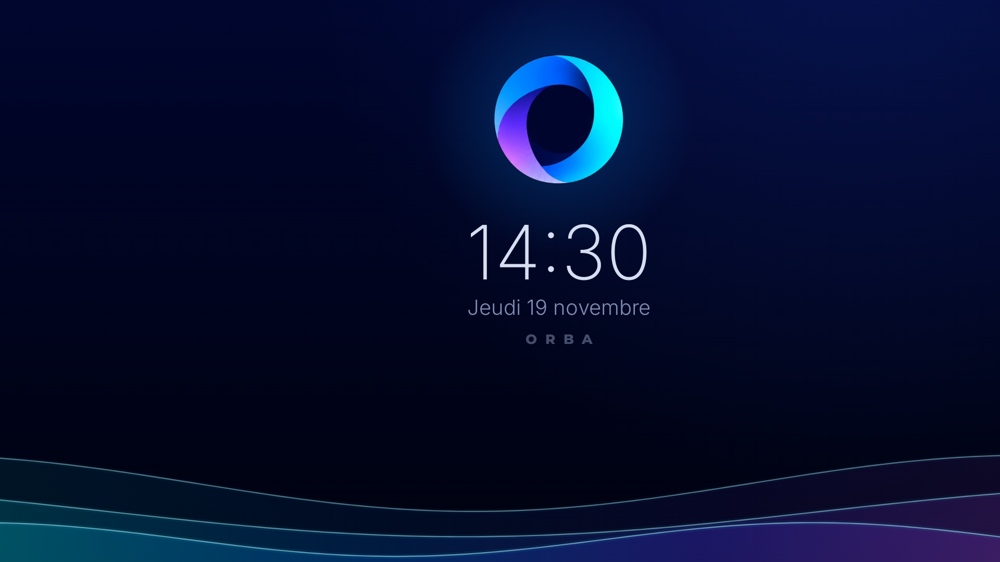
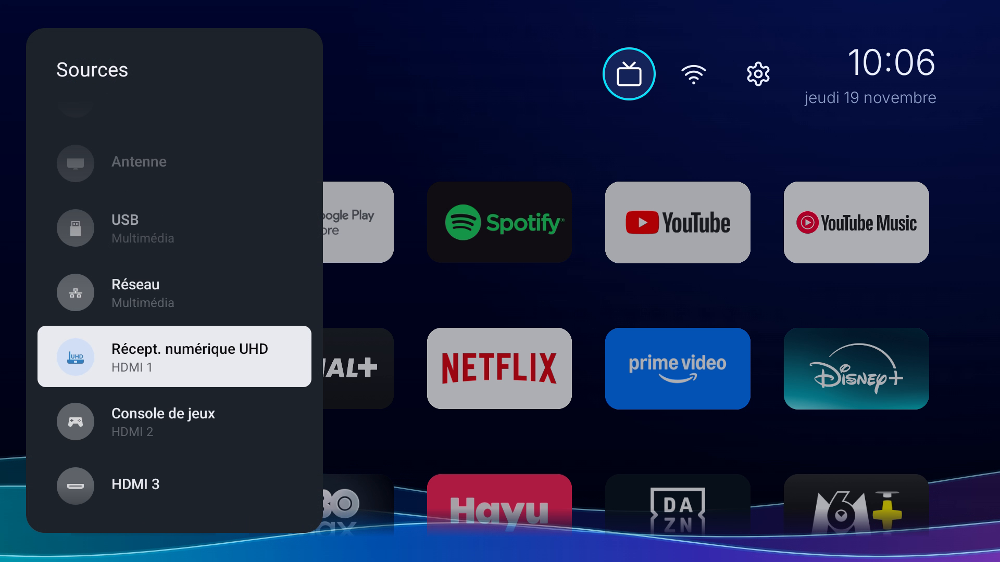

<p align="center">
  
</p>

<h1 align="center">Orba</h1>
<p align="center"><b>A simple, clutter-free launcher for Google TV and Android TV</b></p>

<p align="center">
  <b>English</b> · <a href="README.fr.md">Français</a>
</p>

<p align="center">
  <a href="https://github.com/btalal/OrbaLauncher/releases/latest"></a>
  <a href="https://github.com/btalal/OrbaLauncher/releases"></a>
  <a href="LICENSE"></a>
  
  <a href="https://www.youtube.com/@OrbaTechFR"></a>
</p>

---

Orba replaces the busy Google TV and Android TV home screen with a calm, readable one: the time, the date and
**your apps**, nothing else. No ads, no recommendations, no "Watch next" rows.

<p align="center">
  
</p>

## New in version 3.10

- **Uninstall…** in the tile menu (long-press OK) for the apps you installed. Android asks for confirmation first;
  system apps don't show the option.
- **Smoother screensaver**: the logo, time and date glide at 60 frames per second without stuttering or shimmering.

## Version 3.9

- **App on start-up** (off by default): *Orba settings → On start-up* opens the app of your choice once after the TV
  starts (a TV box app, live TV…). Press Home to get back to Orba. No permission needed.
- **Signal colours**: the Wi-Fi icon turns green, yellow or red with the signal strength.

## Version 3.8: the favourites dock

Your **4 favourite apps** sit in large tiles at the top of Orba, and the selected one's name shows in large type
above them. Long-press OK on any tile → **Add to favourites** (or *Remove from favourites*); *Move* reorders the
dock. On first start the dock is filled with the big streaming apps you already have installed.

## Version 3.7

- 🌐 **Bilingual (English & French)**: Orba automatically follows your TV's language (English or French) for all menus, settings, dates and the screensaver.
- 📺 **Works across Google TV, Android TV & Xiaomi TV**:
  - The Home shortcut service now detects all major stock launchers (`launcherx` on Google TV, `tvlauncher` / `leanbacklauncher` on Android TV, `com.mitv.tvhome` on Xiaomi PatchWall).
  - Orba also declares `CATEGORY_HOME`, so if you debloated your TV and disabled the stock launcher via ADB (e.g. with [CleanYourTV](https://github.com/Gathin23/cleanyourtv)), Orba works as the **native Home app** without even needing the accessibility service.
  - Supports **Android 8.0 (API 26)** and newer.
- 📦 **Sideloaded apps & App info**:
  - Lists both Android TV (`LEANBACK_LAUNCHER`) and standard sideloaded Android apps (`LAUNCHER`).
  - Long-press OK on any tile → **App info…** opens the system details page in one click (to Force Stop, Clear Cache or Uninstall).
- 🔌 **Connected HDMI indicator & physical Input key**:
  - Active HDMI ports show a `●` indicator in the Sources list, and pressing the remote's physical **Input / Source** button opens the Sources panel directly.

## Animated screensaver & On-TV settings (version 3.6)

### Animated screensaver
After a few minutes without touching the remote, Orba shows its screensaver: **the logo ring slowly spins
and pulses**, with the time and date below it, and the whole group **drifts gently across the screen** above
dimmed waves. Nothing stays in place, which makes it ideal for **OLED** screens. Any key returns to the home
screen (volume keys keep working during the screensaver).

<p align="center">
  
</p>

The screensaver is also registered as an **Android screensaver** (named *Orba*), so the TV can use it
everywhere when its brand offers that choice.

### Settings right on the TV
Select the **gear shown at the top of Orba** and **hold the OK button** (the centre button of the remote) to open
*Orba settings* — not the remote's own Settings button, which always opens the TV's settings. Another way in:
long-press OK on any tile → *Orba settings…*. Every choice applies immediately:

| Setting | Options |
|---|---|
| Tiles per row | 4, 5, 6 or 7 |
| Background | Animated waves · Still waves · Pure black (OLED) |
| Selection glow | App colour · Orba cyan |
| Screensaver | Off · after 5, 10, 20 or 30 min |
| Preview screensaver | Instant preview |

A short press on the gear still opens the TV's own settings.

## The Sources button (version 3.5)

A **Sources** button (TV icon) sits in the header next to Wi-Fi: press Up from the grid, then OK (or press the
remote's physical **Input** key), and the list of the TV's inputs opens (HDMI with `●` on active ports, antenna, USB…).

<p align="center">
  
</p>

- **Philips TVs**: the TV's original Sources panel opens.
- **Other Android TVs**: the list of HDMI inputs appears in an Orba-styled window.

▶️ Video demo (in French): [Orba 3.5: the new Sources button](https://www.youtube.com/watch?v=y7Pzcqimt1k)

## Features

- **Clean home screen**: logo, time, date and a grid of apps (4 to 7 per row, including sideloaded apps) with their original logos.
- **Glow** in each app's own colour when it is selected, with its name shown underneath.
- **Animated background**: midnight blue with cyan-to-violet light waves (plus a subtle header pixel-shift) that protect **OLED** screens from burn-in.
- **Animated screensaver** (logo, time and date drifting slowly) and **on-TV settings**.
- **Header** with the **Sources** button, the **Wi-Fi** icon (signal strength; click to open network settings) and the **Settings** gear.
- **Arrange freely**: long-press OK on a tile → *Move*, *App info…*, *Hide from home* or *Hidden apps…*. The **+** tile brings a hidden app back.
- **Opens first**: when the TV turns on and when you press **Home**, Orba appears.
  **Long-press** Home to reach the original Google TV / Android TV home.
- **Bilingual**: English and French (follows the TV's language automatically).
- **Ultra-light & private**: about 315 KB, no `INTERNET` permission, no ads, no tracking.

## Install Orba on an Android TV / Google TV

Requirements: a **Google TV / Android TV** set or box running **Android 8.0 or later**.

### Method A — No computer needed (with the stock launcher kept)

1. **Download the APK** from the project's [Releases](../../releases) page (`orba.apk`).
2. **Install it on the TV**, using one of:
   - the **Downloader** app (Play Store): enter the APK address, then *Install*;
   - a **USB stick** and a file manager;
   - a computer with **ADB** (network debugging enabled on the TV):
     ```bash
     adb connect <tv-ip-address>:5555
     adb install -r orba.apk
     ```
   Android will ask you to allow installing apps from that source: accept it for the app you used.
3. **Turn on the Home shortcut** (needed for Orba to open at start-up and on the Home key when the stock launcher is still enabled):
   *Settings → System → Accessibility → Services → Home Key → Orba (or Touche Accueil → Orba) → On*
4. Press **Home**: Orba appears. You're done.

> **Why an accessibility service?** Google TV does not let you choose another home screen without ADB.
> The "Home Key → Orba" service sees **only** the Home key and the package name of the app on screen
> (to replace the stock home when it shows up). It never reads screen content (`canRetrieveWindowContent="false"`) and records nothing.

### Method B — Native Home (after debloating with ADB / CleanYourTV)

If you disabled the stock launcher over ADB (for example using [CleanYourTV](https://github.com/Gathin23/cleanyourtv)),
Orba declares `android.intent.category.HOME` and answers the Home key **natively** — no accessibility service needed:

```bash
adb connect <tv-ip-address>:5555
adb install -r orba.apk
adb shell cmd package set-home-activity fr.maison.accueil/.MainActivity
```

> **Philips TVs:** don't disable the *Help* app (`org.droidtv.eum`): the Sources panel needs it to open.
> Orba simply hides it from the home screen by default.

### Undo

Turn the service off in *Settings → System → Accessibility*, or uninstall Orba
(*Settings → Apps → Orba → Uninstall*). The original home screen comes back as it was.

## Tested TVs & Boxes

| TV / box | System | Status |
|---|---|---|
| **Philips 65OLED908/12** | Google TV 14 | ✅ Tested every day: Home key, native Sources panel, screensaver, settings, English and French |
| Other Google TV / Android TV sets and boxes (Sony, TCL, Hisense, Xiaomi, NVIDIA Shield, Chromecast with Google TV…) | Android 8.0 or later | ❔ Not tested yet. Orba is built for them (stock launchers `launcherx`, `tvlauncher`, `leanbacklauncher` and Xiaomi's `com.mitv.tvhome` are recognised), but nobody has reported back |

*Using Orba on another model? Tell us how it went in [Discussions](../../discussions) or with a
[bug report](../../issues/new/choose), and your TV joins this table.*

## Clean up your TV (optional)

[`tools/`](tools/README.md) holds two PowerShell scripts that **disable** (never uninstall) the bloat of an
Android TV over ADB, with a backup and a log, and the list tested on the **Philips 65OLED908**: Samba TV and
Philips analytics, Google feedback, retail demo, Control4, Alexa, Play-Fi… Everything comes back with
`tools\restore.ps1`.

## Build the APK yourself (Windows)

No Gradle: the APK is built directly with the Android SDK tools in a couple of seconds.

- Android SDK (build-tools and a recent platform) in `%LOCALAPPDATA%\Android\Sdk`
- The JDK bundled with Android Studio (`C:\Program Files\Android\Android Studio\jbr`)

```powershell
.\build.ps1        # compile, package, align and sign -> orbalauncher.apk
.\icone.ps1        # (re)generate the icon, banner and logo from source-logo\
```

`build.ps1` creates a local signing key `cle-accueil.jks` if it doesn't exist.
**It is not in the repository**: keep it safe, because an update can only install over the existing
app when it is signed with the same key.

GitHub also builds the APK on every push and pull request (*Actions* tab), and attaches a signed `orba.apk` to
the release when a `v*` tag is pushed (see [CONTRIBUTING.md](CONTRIBUTING.md#releases-maintainer)).

## Contributing

Ideas, bug reports and translations are welcome: see [CONTRIBUTING.md](CONTRIBUTING.md), the
[issue forms](../../issues/new/choose) and [Discussions](../../discussions). What changed in each version is in
[CHANGELOG.md](CHANGELOG.md).

## Code layout

| Path | Role |
|---|---|
| `src/fr/maison/accueil/MainActivity.java` | Home screen: header, grid, glow, menus, app info, settings, animated background |
| `src/fr/maison/accueil/Veille.java`, `VeilleActivity.java`, `OrbaDream.java` | Animated screensaver (and Android screensaver) |
| `src/fr/maison/accueil/ToucheAccueilService.java` | Accessibility service: Home key and replacing the stock home screen |
| `res/` | Icon, banner, logo, Settings icon, EN/FR strings |
| `assets/` | Inter and Montserrat fonts (OFL licence) |
| `source-logo/` | Original Orba logo (image and SVG) |
| `build.ps1`, `icone.ps1`, `Logo.cs` | APK build and artwork generation |
| `tools/` | TV cleanup scripts and the list tested on the Philips 65OLED908 |
| `.github/` | Automatic APK build, issue forms and pull request checklist |

## License and credits

- Code under the **MIT license** (see [LICENSE](LICENSE)). The "Orba" name and logo are not covered by this license (see [NOTICE](NOTICE)).
- **[Inter](https://rsms.me/inter/)** and **[Montserrat](https://github.com/JulietaUla/Montserrat)** fonts — SIL Open Font License 1.1 (licences in `assets/`).
- Settings, Sources and Wi-Fi icons adapted from **[Lucide](https://lucide.dev)** — ISC License.
- App logos: provided by each installed app (trademarks of their respective owners).
